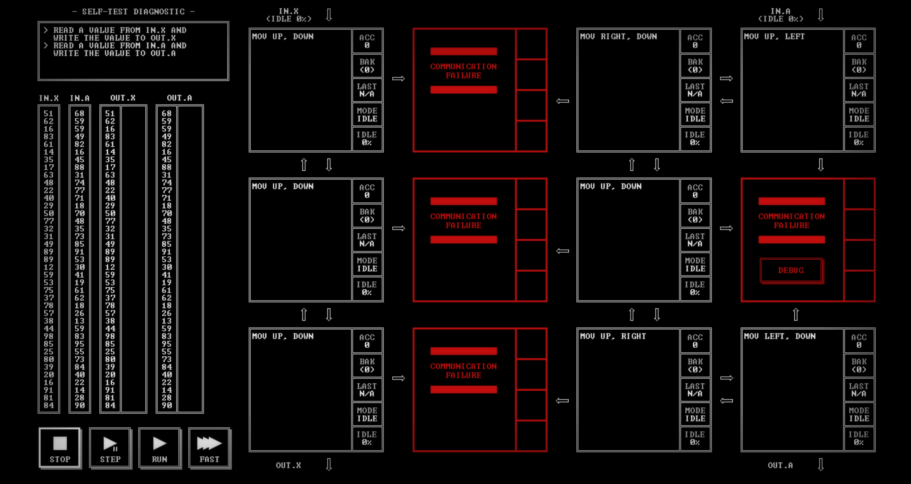

# SELF-TEST DIAGNOSTIC

## 1. Problem statement

Original text shown in the screenshot:

```text
READ A VALUE FROM IN.X AND
WRITE THE VALUE TO OUT.X
READ A VALUE FROM IN.A AND
WRITE THE VALUE TO OUT.A
```

## 2. Code for each node

**Numbering convention:** these are our own position numbers, not IDs displayed by the game. Positions are numbered from left to right and top to bottom, including those marked `COMMUNICATION FAILURE`.

```text
                  IN.X                                 IN.A
                    ↓                                    ↓
Row 1:             [ 1 ]       [ 2 ✕ ]      [ 3 ]       [ 4 ]
Row 2:             [ 5 ]       [ 6 ✕ ]      [ 7 ]       [ 8 ✕ ]
Row 3:             [ 9 ]       [10 ✕ ]      [11 ]       [12 ]
                    ↓                                    ↓
                  OUT.X                                OUT.A

✕ = COMMUNICATION FAILURE
```

### Node 1 — row 1, column 1

```asm
MOV UP, DOWN
```

### Node 2 — row 1, column 2

Displays `COMMUNICATION FAILURE`. No code is visible.

### Node 3 — row 1, column 3

```asm
MOV RIGHT, DOWN
```

### Node 4 — row 1, column 4

```asm
MOV UP, LEFT
```

### Node 5 — row 2, column 1

```asm
MOV UP, DOWN
```

### Node 6 — row 2, column 2

Displays `COMMUNICATION FAILURE`. No code is visible.

### Node 7 — row 2, column 3

```asm
MOV UP, DOWN
```

### Node 8 — row 2, column 4

Displays `COMMUNICATION FAILURE` and a `DEBUG` button. No code is visible.

### Node 9 — row 3, column 1

```asm
MOV UP, DOWN
```

### Node 10 — row 3, column 2

Displays `COMMUNICATION FAILURE`. No code is visible.

### Node 11 — row 3, column 3

```asm
MOV UP, RIGHT
```

### Node 12 — row 3, column 4

```asm
MOV LEFT, DOWN
```

## 3. Screenshots

Original solution screenshot, copied without modification:



## 4. Brief explanation

The `MOV` instructions forward values from the first named port to the second, without arithmetic processing. The visible code describes two independent routes:

- **X route:** `IN.X → 1 → 5 → 9 → OUT.X`. All three nodes forward each value from their upper port to their lower port.
- **A route:** `IN.A → 4 → 3 → 7 → 11 → 12 → OUT.A`. Node 4 sends left to node 3; nodes 3 and 7 send down; node 11 sends right to node 12; and node 12 sends down to the output. This route bypasses the communication failure at position 8.

**Transcription confidence: very high.** The title, problem statement, eight instructions, and their positions are clearly readable. No ambiguous characters were identified. The grid contains eight working nodes and four positions marked `COMMUNICATION FAILURE`. Node numbers correspond to the positions in the grid above.

**Verification limit:** the screenshot shows the working nodes in `MODE IDLE` and contains no completion screen or score. The explanation describes the flow specified by the code; it does not confirm a successful execution. No performance metrics are recorded.
