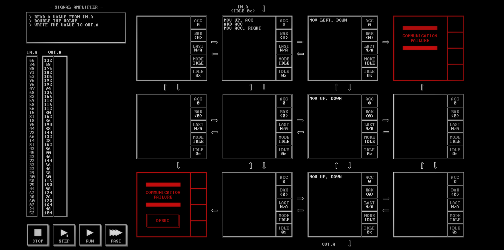

# SIGNAL AMPLIFIER

[Back to the solution index](../README.md)

## 1. Problem statement

Original text shown in the screenshot:

```text
READ A VALUE FROM IN.A
DOUBLE THE VALUE
WRITE THE VALUE TO OUT.A
```

## 2. Code for each node

**Numbering convention:** these are our own position numbers, not IDs displayed by the game. Positions are numbered from left to right and top to bottom, including blank nodes, communication failures, and stack memory nodes. Rows and columns start at 1.

```text
[ 1.] [ 2 ] [ 3 ] [ 4!]
[ 5.] [ 6.] [ 7 ] [ 8.]
[ 9!] [10.] [11 ] [12.]

! = COMMUNICATION FAILURE
S = STACK MEMORY NODE
. = visibly blank code area
```

`IN.A` enters above node 2; `OUT.A` leaves below node 11.

### Node 1 — row 1, column 1

The code area is visibly blank.

### Node 2 — row 1, column 2

```asm
MOV UP, ACC
ADD ACC
MOV ACC, RIGHT
```

### Node 3 — row 1, column 3

```asm
MOV LEFT, DOWN
```

### Node 4 — row 1, column 4

Displays `COMMUNICATION FAILURE`. No code is visible.

### Node 5 — row 2, column 1

The code area is visibly blank.

### Node 6 — row 2, column 2

The code area is visibly blank.

### Node 7 — row 2, column 3

```asm
MOV UP, DOWN
```

### Node 8 — row 2, column 4

The code area is visibly blank.

### Node 9 — row 3, column 1

Displays `COMMUNICATION FAILURE` and a `DEBUG` button. No code is visible.

### Node 10 — row 3, column 2

The code area is visibly blank.

### Node 11 — row 3, column 3

```asm
MOV UP, DOWN
```

### Node 12 — row 3, column 4

The code area is visibly blank.

## 3. Screenshots

Original screenshot, copied without modification. Open the image to inspect the full-size source.



## 4. Brief explanation

Node 2 reads each input into `ACC`, doubles it with `ADD ACC`, and sends the result right. Nodes 3, 7, and 11 forward it to the output.

**Route:** `IN.A → 2 → 3 → 7 → 11 → OUT.A`.

**Transcription confidence: high.** The visible instructions, operands, labels, and node positions are readable. This grid has 4 nodes with code, 6 visibly blank code areas, 2 communication failure position(s), and 0 stack memory node(s).

**Verification limit:** this screenshot shows the code in an idle state, with no completion screen or score. The explanation is a reading of the visible program, not a claim of a successful run. Target output values or target images are not execution results. No performance metrics are recorded.
