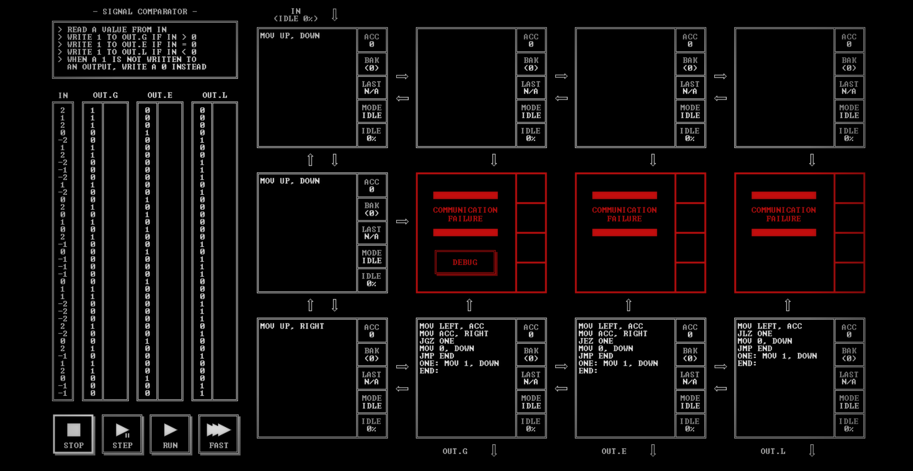

# SIGNAL COMPARATOR

[Back to the solution index](../README.md)

## 1. Problem statement

Original text shown in the screenshot:

```text
READ A VALUE FROM IN
WRITE 1 TO OUT.G IF IN > 0
WRITE 1 TO OUT.E IF IN = 0
WRITE 1 TO OUT.L IF IN < 0
WHEN A 1 IS NOT WRITTEN TO
AN OUTPUT, WRITE A 0 INSTEAD
```

## 2. Code for each node

**Numbering convention:** these are our own position numbers, not IDs displayed by the game. Positions are numbered from left to right and top to bottom, including blank nodes, communication failures, and stack memory nodes. Rows and columns start at 1.

```text
[ 1 ] [ 2.] [ 3.] [ 4.]
[ 5 ] [ 6!] [ 7!] [ 8!]
[ 9 ] [10 ] [11 ] [12 ]

! = COMMUNICATION FAILURE
S = STACK MEMORY NODE
. = visibly blank code area
```

`IN` enters above node 1. `OUT.G`, `OUT.E`, and `OUT.L` leave below nodes 10, 11, and 12, respectively.

### Node 1 — row 1, column 1

```asm
MOV UP, DOWN
```

### Node 2 — row 1, column 2

The code area is visibly blank.

### Node 3 — row 1, column 3

The code area is visibly blank.

### Node 4 — row 1, column 4

The code area is visibly blank.

### Node 5 — row 2, column 1

```asm
MOV UP, DOWN
```

### Node 6 — row 2, column 2

Displays `COMMUNICATION FAILURE` and a `DEBUG` button. No code is visible.

### Node 7 — row 2, column 3

Displays `COMMUNICATION FAILURE`. No code is visible.

### Node 8 — row 2, column 4

Displays `COMMUNICATION FAILURE`. No code is visible.

### Node 9 — row 3, column 1

```asm
MOV UP, RIGHT
```

### Node 10 — row 3, column 2

```asm
MOV LEFT, ACC
MOV ACC, RIGHT
JGZ ONE
MOV 0, DOWN
JMP END
ONE: MOV 1, DOWN
END:
```

### Node 11 — row 3, column 3

```asm
MOV LEFT, ACC
MOV ACC, RIGHT
JEZ ONE
MOV 0, DOWN
JMP END
ONE: MOV 1, DOWN
END:
```

### Node 12 — row 3, column 4

```asm
MOV LEFT, ACC
JLZ ONE
MOV 0, DOWN
JMP END
ONE: MOV 1, DOWN
END:
```

## 3. Screenshots

Original screenshot, copied without modification. Open the image to inspect the full-size source.



## 4. Brief explanation

Nodes 1, 5, and 9 route the input to the bottom row. Nodes 10 and 11 pass the original value right before testing their own copy in `ACC`.

Node 10 tests for a positive value (`JGZ`), node 11 for zero (`JEZ`), and node 12 for a negative value (`JLZ`). Each writes 1 when its condition holds and 0 otherwise, so every input produces a value on all three outputs.

**Input route:** `IN → 1 → 5 → 9 → 10 → 11 → 12`. Each of the last three nodes also writes down to its respective output.

**Transcription confidence: high.** The visible instructions, operands, labels, and node positions are readable. This grid has 6 nodes with code, 3 visibly blank code areas, 3 communication failure position(s), and 0 stack memory node(s).

**Verification limit:** this screenshot shows the code in an idle state, with no completion screen or score. The explanation is a reading of the visible program, not a claim of a successful run. Target output values or target images are not execution results. No performance metrics are recorded.
