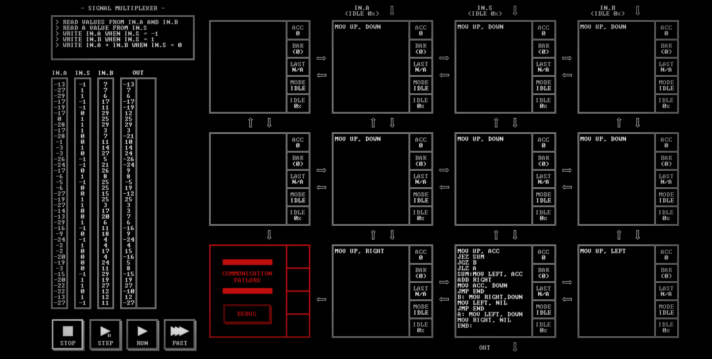

# SIGNAL MULTIPLEXER

[Back to the solution index](../README.md)

## 1. Problem statement

Original text shown in the screenshot:

```text
READ VALUES FROM IN.A AND IN.B
READ A VALUE FROM IN.S
WRITE IN.A WHEN IN.S = -1
WRITE IN.B WHEN IN.S = 1
WRITE IN.A + IN.B WHEN IN.S = 0
```

## 2. Code for each node

**Numbering convention:** these are our own position numbers, not IDs displayed by the game. Positions are numbered from left to right and top to bottom, including blank nodes, communication failures, and stack memory nodes. Rows and columns start at 1.

```text
[ 1.] [ 2 ] [ 3 ] [ 4 ]
[ 5.] [ 6 ] [ 7 ] [ 8 ]
[ 9!] [10 ] [11 ] [12 ]

! = COMMUNICATION FAILURE
S = STACK MEMORY NODE
. = visibly blank code area
```

`IN.A`, `IN.S`, and `IN.B` enter above nodes 2, 3, and 4. `OUT` leaves below node 11.

### Node 1 — row 1, column 1

The code area is visibly blank.

### Node 2 — row 1, column 2

```asm
MOV UP, DOWN
```

### Node 3 — row 1, column 3

```asm
MOV UP, DOWN
```

### Node 4 — row 1, column 4

```asm
MOV UP, DOWN
```

### Node 5 — row 2, column 1

The code area is visibly blank.

### Node 6 — row 2, column 2

```asm
MOV UP, DOWN
```

### Node 7 — row 2, column 3

```asm
MOV UP, DOWN
```

### Node 8 — row 2, column 4

```asm
MOV UP, DOWN
```

### Node 9 — row 3, column 1

Displays `COMMUNICATION FAILURE` and a `DEBUG` button. No code is visible.

### Node 10 — row 3, column 2

```asm
MOV UP, RIGHT
```

### Node 11 — row 3, column 3

```asm
MOV UP, ACC
JEZ SUM
JGZ B
JLZ A
SUM:MOV LEFT, ACC
ADD RIGHT
MOV ACC, DOWN
JMP END
B: MOV RIGHT,DOWN
MOV LEFT, NIL
JMP END
A: MOV LEFT, DOWN
MOV RIGHT, NIL
END:
```

### Node 12 — row 3, column 4

```asm
MOV UP, LEFT
```

## 3. Screenshots

Original screenshot, copied without modification. Open the image to inspect the full-size source.



## 4. Brief explanation

The three input streams travel down separate columns: A reaches node 11 from node 10 on the left, S arrives from node 7 above, and B arrives from node 12 on the right.

Node 11 reads S into `ACC`. A zero selects the sum of A and B; a positive value selects B; a negative value selects A. In either single-input branch, `MOV ..., NIL` consumes the unused value as well, keeping the two data streams aligned for the next selection.

**Transcription confidence: high.** The visible instructions, operands, labels, and node positions are readable. This grid has 9 nodes with code, 2 visibly blank code areas, 1 communication failure position(s), and 0 stack memory node(s).

**Verification limit:** this screenshot shows the code in an idle state, with no completion screen or score. The explanation is a reading of the visible program, not a claim of a successful run. Target output values or target images are not execution results. No performance metrics are recorded.
