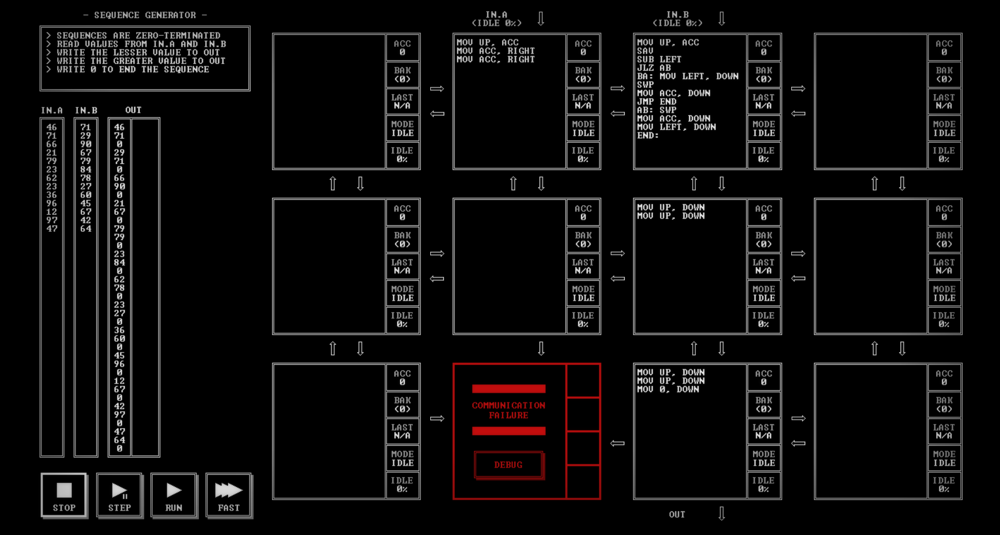

# SEQUENCE GENERATOR

[Back to the solution index](../README.md)

## 1. Problem statement

Original text shown in the screenshot:

```text
SEQUENCES ARE ZERO-TERMINATED
READ VALUES FROM IN.A AND IN.B
WRITE THE LESSER VALUE TO OUT
WRITE THE GREATER VALUE TO OUT
WRITE 0 TO END THE SEQUENCE
```

## 2. Code for each node

**Numbering convention:** these are our own position numbers, not IDs displayed by the game. Positions are numbered from left to right and top to bottom, including blank nodes, communication failures, and stack memory nodes. Rows and columns start at 1.

```text
[ 1.] [ 2 ] [ 3 ] [ 4.]
[ 5.] [ 6.] [ 7 ] [ 8.]
[ 9.] [10!] [11 ] [12.]

! = COMMUNICATION FAILURE
S = STACK MEMORY NODE
. = visibly blank code area
```

`IN.A` enters above node 2; `IN.B` above node 3. `OUT` leaves below node 11.

### Node 1 — row 1, column 1

The code area is visibly blank.

### Node 2 — row 1, column 2

```asm
MOV UP, ACC
MOV ACC, RIGHT
MOV ACC, RIGHT
```

### Node 3 — row 1, column 3

```asm
MOV UP, ACC
SAV
SUB LEFT
JLZ AB
BA: MOV LEFT, DOWN
SWP
MOV ACC, DOWN
JMP END
AB: SWP
MOV ACC, DOWN
MOV LEFT, DOWN
END:
```

### Node 4 — row 1, column 4

The code area is visibly blank.

### Node 5 — row 2, column 1

The code area is visibly blank.

### Node 6 — row 2, column 2

The code area is visibly blank.

### Node 7 — row 2, column 3

```asm
MOV UP, DOWN
MOV UP, DOWN
```

### Node 8 — row 2, column 4

The code area is visibly blank.

### Node 9 — row 3, column 1

The code area is visibly blank.

### Node 10 — row 3, column 2

Displays `COMMUNICATION FAILURE` and a `DEBUG` button. No code is visible.

### Node 11 — row 3, column 3

```asm
MOV UP, DOWN
MOV UP, DOWN
MOV 0, DOWN
```

### Node 12 — row 3, column 4

The code area is visibly blank.

## 3. Screenshots

Original screenshot, copied without modification. Open the image to inspect the full-size source.



## 4. Brief explanation

Node 2 sends A twice: one copy for the comparison and one for output. Node 3 saves B in `BAK`, then computes `B - A` using the first copy. If the result is negative, it outputs B before A; otherwise it outputs A before B. `SWP` recovers the saved B.

Node 7 forwards both values. Node 11 forwards the pair and appends a zero terminator, producing `min(A, B), max(A, B), 0`. Equal inputs are both retained.

**Transcription confidence: high.** The visible instructions, operands, labels, and node positions are readable. This grid has 4 nodes with code, 7 visibly blank code areas, 1 communication failure position(s), and 0 stack memory node(s).

**Verification limit:** this screenshot shows the code in an idle state, with no completion screen or score. The explanation is a reading of the visible program, not a claim of a successful run. Target output values or target images are not execution results. No performance metrics are recorded.
