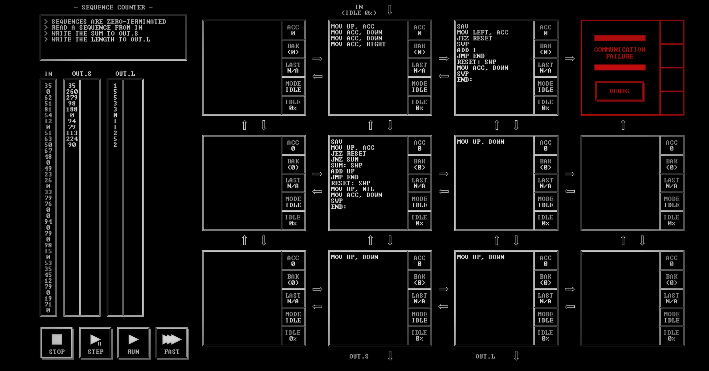

# SEQUENCE COUNTER

[Back to the solution index](../README.md)

## 1. Problem statement

Original text shown in the screenshot:

```text
SEQUENCES ARE ZERO-TERMINATED
READ A SEQUENCE FROM IN
WRITE THE SUM TO OUT.S
WRITE THE LENGTH TO OUT.L
```

## 2. Code for each node

**Numbering convention:** these are our own position numbers, not IDs displayed by the game. Positions are numbered from left to right and top to bottom, including blank nodes, communication failures, and stack memory nodes. Rows and columns start at 1.

```text
[ 1.] [ 2 ] [ 3 ] [ 4!]
[ 5.] [ 6 ] [ 7 ] [ 8.]
[ 9.] [10 ] [11 ] [12.]

! = COMMUNICATION FAILURE
S = STACK MEMORY NODE
. = visibly blank code area
```

`IN` enters above node 2. `OUT.S` leaves below node 10; `OUT.L` below node 11.

### Node 1 — row 1, column 1

The code area is visibly blank.

### Node 2 — row 1, column 2

```asm
MOV UP, ACC
MOV ACC, DOWN
MOV ACC, DOWN
MOV ACC, RIGHT
```

### Node 3 — row 1, column 3

```asm
SAV
MOV LEFT, ACC
JEZ RESET
SWP
ADD 1
JMP END
RESET: SWP
MOV ACC, DOWN
SWP
END:
```

### Node 4 — row 1, column 4

Displays `COMMUNICATION FAILURE` and a `DEBUG` button. No code is visible.

### Node 5 — row 2, column 1

The code area is visibly blank.

### Node 6 — row 2, column 2

```asm
SAV
MOV UP, ACC
JEZ RESET
JNZ SUM
SUM: SWP
ADD UP
JMP END
RESET: SWP
MOV UP, NIL
MOV ACC, DOWN
SWP
END:
```

### Node 7 — row 2, column 3

```asm
MOV UP, DOWN
```

### Node 8 — row 2, column 4

The code area is visibly blank.

### Node 9 — row 3, column 1

The code area is visibly blank.

### Node 10 — row 3, column 2

```asm
MOV UP, DOWN
```

### Node 11 — row 3, column 3

```asm
MOV UP, DOWN
```

### Node 12 — row 3, column 4

The code area is visibly blank.

## 3. Screenshots

Original screenshot, copied without modification. Open the image to inspect the full-size source.



## 4. Brief explanation

Node 2 sends each input twice down to the sum accumulator at node 6 and once right to the length accumulator at node 3.

Node 6 checks the first copy for a zero terminator. For a nonzero value, it restores the running sum and adds the second copy. At zero, it discards the second zero, emits the sum, and restores zero for the next sequence. Node 3 increments its saved count for each nonzero input; at zero it emits the count and resets it.

Nodes 10 and 7 → 11 forward the sum and length to their outputs. A sequence containing only its zero terminator yields sum 0 and length 0.

**Transcription confidence: high.** The visible instructions, operands, labels, and node positions are readable. This grid has 6 nodes with code, 5 visibly blank code areas, 1 communication failure position(s), and 0 stack memory node(s).

**Verification limit:** this screenshot shows the code in an idle state, with no completion screen or score. The explanation is a reading of the visible program, not a claim of a successful run. Target output values or target images are not execution results. No performance metrics are recorded.
