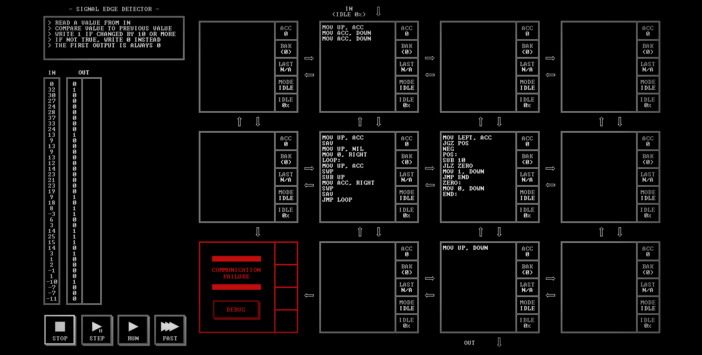

# SIGNAL EDGE DETECTOR

[Back to the solution index](../README.md)

## 1. Problem statement

Original text shown in the screenshot:

```text
READ A VALUE FROM IN
COMPARE VALUE TO PREVIOUS VALUE
WRITE 1 IF CHANGED BY 10 OR MORE
IF NOT TRUE, WRITE 0 INSTEAD
THE FIRST OUTPUT IS ALWAYS 0
```

## 2. Code for each node

**Numbering convention:** these are our own position numbers, not IDs displayed by the game. Positions are numbered from left to right and top to bottom, including blank nodes, communication failures, and stack memory nodes. Rows and columns start at 1.

```text
[ 1.] [ 2 ] [ 3.] [ 4.]
[ 5.] [ 6 ] [ 7 ] [ 8.]
[ 9!] [10.] [11 ] [12.]

! = COMMUNICATION FAILURE
S = STACK MEMORY NODE
. = visibly blank code area
```

`IN` enters above node 2; `OUT` leaves below node 11.

### Node 1 — row 1, column 1

The code area is visibly blank.

### Node 2 — row 1, column 2

```asm
MOV UP, ACC
MOV ACC, DOWN
MOV ACC, DOWN
```

### Node 3 — row 1, column 3

The code area is visibly blank.

### Node 4 — row 1, column 4

The code area is visibly blank.

### Node 5 — row 2, column 1

The code area is visibly blank.

### Node 6 — row 2, column 2

```asm
MOV UP, ACC
SAV
MOV UP, NIL
MOV 0, RIGHT
LOOP:
MOV UP, ACC
SWP
SUB UP
MOV ACC, RIGHT
SWP
SAV
JMP LOOP
```

### Node 7 — row 2, column 3

```asm
MOV LEFT, ACC
JGZ POS
NEG
POS:
SUB 10
JLZ ZERO
MOV 1, DOWN
JMP END
ZERO:
MOV 0, DOWN
END:
```

### Node 8 — row 2, column 4

The code area is visibly blank.

### Node 9 — row 3, column 1

Displays `COMMUNICATION FAILURE` and a `DEBUG` button. No code is visible.

### Node 10 — row 3, column 2

The code area is visibly blank.

### Node 11 — row 3, column 3

```asm
MOV UP, DOWN
```

### Node 12 — row 3, column 4

The code area is visibly blank.

## 3. Screenshots

Original screenshot, copied without modification. Open the image to inspect the full-size source.



## 4. Brief explanation

Node 2 sends two copies of each sample down. Node 6 initializes the saved previous value from the first sample, consumes its duplicate, and sends a zero difference so the first output is 0.

For later samples, node 6 uses one copy to preserve the new sample while it subtracts the other from the previous sample. It sends `previous - current` right, then saves the current sample for the next iteration.

Node 7 converts the difference to its absolute value, subtracts 10, and emits 1 if the result is nonnegative, or 0 otherwise. Node 11 forwards the flag to `OUT`.

**Transcription confidence: high.** The visible instructions, operands, labels, and node positions are readable. This grid has 4 nodes with code, 7 visibly blank code areas, 1 communication failure position(s), and 0 stack memory node(s).

**Verification limit:** this screenshot shows the code in an idle state, with no completion screen or score. The explanation is a reading of the visible program, not a claim of a successful run. Target output values or target images are not execution results. No performance metrics are recorded.
