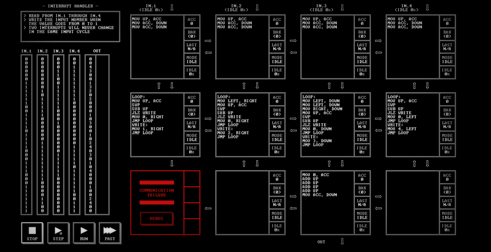

# INTERRUPT HANDLER

[Back to the solution index](../README.md)

## 1. Problem statement

Original text shown in the screenshot:

```text
READ FROM IN.1 THROUGH IN.4
WRITE THE INPUT NUMBER WHEN
THE VALUE GOES FROM 0 TO 1
TWO INTERRUPTS WILL NEVER CHANGE
IN THE SAME INPUT CYCLE
```

## 2. Code for each node

**Numbering convention:** these are our own position numbers, not IDs displayed by the game. Positions are numbered from left to right and top to bottom, including blank nodes, communication failures, and stack memory nodes. Rows and columns start at 1.

```text
[ 1 ] [ 2 ] [ 3 ] [ 4 ]
[ 5 ] [ 6 ] [ 7 ] [ 8 ]
[ 9!] [10.] [11 ] [12.]

! = COMMUNICATION FAILURE
S = STACK MEMORY NODE
. = visibly blank code area
```

`IN.1` through `IN.4` enter above nodes 1 through 4. `OUT` leaves below node 11.

### Node 1 — row 1, column 1

```asm
MOV UP, ACC
MOV ACC, DOWN
MOV ACC, DOWN
```

### Node 2 — row 1, column 2

```asm
MOV UP, ACC
MOV ACC, DOWN
MOV ACC, DOWN
```

### Node 3 — row 1, column 3

```asm
MOV UP, ACC
MOV ACC, DOWN
MOV ACC, DOWN
```

### Node 4 — row 1, column 4

```asm
MOV UP, ACC
MOV ACC, DOWN
MOV ACC, DOWN
```

### Node 5 — row 2, column 1

```asm
LOOP:
MOV UP, ACC
SWP
SUB UP
JLZ WRITE
MOV 0, RIGHT
JMP LOOP
WRITE:
MOV 1, RIGHT
JMP LOOP
```

### Node 6 — row 2, column 2

```asm
LOOP:
MOV LEFT, RIGHT
MOV UP, ACC
SWP
SUB UP
JLZ WRITE
MOV 0, RIGHT
JMP LOOP
WRITE:
MOV 2, RIGHT
JMP LOOP
```

### Node 7 — row 2, column 3

```asm
LOOP:
MOV LEFT, DOWN
MOV LEFT, DOWN
MOV RIGHT, DOWN
MOV UP, ACC
SWP
SUB UP
JLZ WRITE
MOV 0, DOWN
JMP LOOP
WRITE:
MOV 3, DOWN
JMP LOOP
```

### Node 8 — row 2, column 4

```asm
LOOP:
MOV UP, ACC
SWP
SUB UP
JLZ WRITE
MOV 0, LEFT
JMP LOOP
WRITE:
MOV 4, LEFT
JMP LOOP
```

### Node 9 — row 3, column 1

Displays `COMMUNICATION FAILURE` and a `DEBUG` button. No code is visible.

### Node 10 — row 3, column 2

The code area is visibly blank.

### Node 11 — row 3, column 3

```asm
MOV 0, ACC
ADD UP
ADD UP
ADD UP
ADD UP
MOV ACC, DOWN
```

### Node 12 — row 3, column 4

The code area is visibly blank.

## 3. Screenshots

Original screenshot, copied without modification. Open the image to inspect the full-size source.



## 4. Brief explanation

The top row duplicates each input sample. Nodes 5–8 retain the previous sample in `BAK` and calculate `previous - current`. For binary inputs, a negative result identifies a rising edge from 0 to 1. Each detector emits its input number on a rising edge and 0 otherwise.

Node 6 forwards detector 1 before its own result. Node 7 forwards results from detectors 1, 2, and 4, then its own result. Node 11 sums these four contributions. Under the stated one-change-per-input-cycle condition, that sum is the rising input number, or 0 if none rose.

**Transcription confidence: high.** The visible instructions, operands, labels, and node positions are readable. This grid has 9 nodes with code, 2 visibly blank code areas, 1 communication failure position(s), and 0 stack memory node(s).

**Verification limit:** this screenshot shows the code in an idle state, with no completion screen or score. The explanation is a reading of the visible program, not a claim of a successful run. Target output values or target images are not execution results. No performance metrics are recorded.
