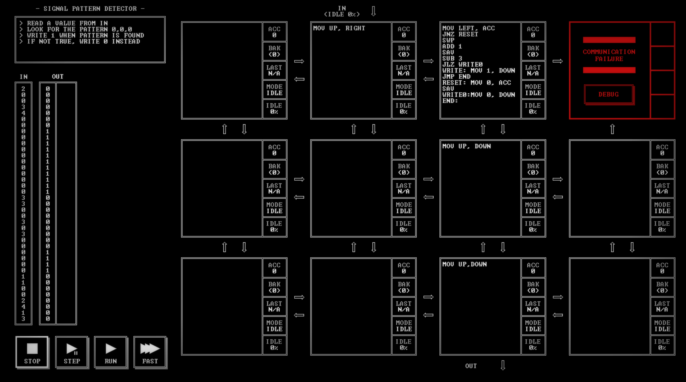

# SIGNAL PATTERN DETECTOR

[Back to the solution index](../README.md)

## 1. Problem statement

Original text shown in the screenshot:

```text
READ A VALUE FROM IN
LOOK FOR THE PATTERN 0,0,0
WRITE 1 WHEN PATTERN IS FOUND
IF NOT TRUE, WRITE 0 INSTEAD
```

## 2. Code for each node

**Numbering convention:** these are our own position numbers, not IDs displayed by the game. Positions are numbered from left to right and top to bottom, including blank nodes, communication failures, and stack memory nodes. Rows and columns start at 1.

```text
[ 1.] [ 2 ] [ 3 ] [ 4!]
[ 5.] [ 6.] [ 7 ] [ 8.]
[ 9.] [10.] [11 ] [12.]

! = COMMUNICATION FAILURE
S = STACK MEMORY NODE
. = visibly blank code area
```

`IN` enters above node 2; `OUT` leaves below node 11.

### Node 1 — row 1, column 1

The code area is visibly blank.

### Node 2 — row 1, column 2

```asm
MOV UP, RIGHT
```

### Node 3 — row 1, column 3

```asm
MOV LEFT, ACC
JNZ RESET
SWP
ADD 1
SAV
SUB 3
JLZ WRITE0
WRITE: MOV 1, DOWN
JMP END
RESET: MOV 0, ACC
SAV
WRITE0:MOV 0, DOWN
END:
```

### Node 4 — row 1, column 4

Displays `COMMUNICATION FAILURE` and a `DEBUG` button. No code is visible.

### Node 5 — row 2, column 1

The code area is visibly blank.

### Node 6 — row 2, column 2

The code area is visibly blank.

### Node 7 — row 2, column 3

```asm
MOV UP, DOWN
```

### Node 8 — row 2, column 4

The code area is visibly blank.

### Node 9 — row 3, column 1

The code area is visibly blank.

### Node 10 — row 3, column 2

The code area is visibly blank.

### Node 11 — row 3, column 3

```asm
MOV UP,DOWN
```

### Node 12 — row 3, column 4

The code area is visibly blank.

## 3. Screenshots

Original screenshot, copied without modification. Open the image to inspect the full-size source.



## 4. Brief explanation

Node 2 forwards the input to node 3. Node 3 keeps the consecutive-zero count in `BAK`. A zero restores and increments that count, saves it, and compares it with 3. A nonzero value resets the saved count and emits 0.

Once the count reaches 3, each further zero emits 1 as well: the code detects overlapping three-zero windows. For example, the input `0, 0, 0, 0` produces `0, 0, 1, 1`. Nodes 7 and 11 forward the result.

**Transcription confidence: high.** The visible instructions, operands, labels, and node positions are readable. This grid has 4 nodes with code, 7 visibly blank code areas, 1 communication failure position(s), and 0 stack memory node(s).

**Verification limit:** this screenshot shows the code in an idle state, with no completion screen or score. The explanation is a reading of the visible program, not a claim of a successful run. Target output values or target images are not execution results. No performance metrics are recorded.
