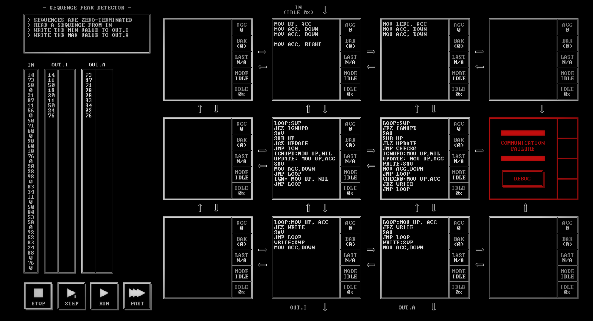

# SEQUENCE PEAK DETECTOR

[Back to the solution index](../README.md)

## 1. Problem statement

Original text shown in the screenshot:

```text
SEQUENCES ARE ZERO-TERMINATED
READ A SEQUENCE FROM IN
WRITE THE MIN VALUE TO OUT.I
WRITE THE MAX VALUE TO OUT.A
```

## 2. Code for each node

**Numbering convention:** these are our own position numbers, not IDs displayed by the game. Positions are numbered from left to right and top to bottom, including blank nodes, communication failures, and stack memory nodes. Rows and columns start at 1.

```text
[ 1.] [ 2 ] [ 3 ] [ 4.]
[ 5.] [ 6 ] [ 7 ] [ 8!]
[ 9.] [10 ] [11 ] [12.]

! = COMMUNICATION FAILURE
S = STACK MEMORY NODE
. = visibly blank code area
```

`IN` enters above node 2. `OUT.I` leaves below node 10; `OUT.A` below node 11.

### Node 1 — row 1, column 1

The code area is visibly blank.

### Node 2 — row 1, column 2

```asm
MOV UP, ACC
MOV ACC, DOWN
MOV ACC, DOWN

MOV ACC, RIGHT
```

### Node 3 — row 1, column 3

```asm
MOV LEFT, ACC
MOV ACC, DOWN
MOV ACC, DOWN
```

### Node 4 — row 1, column 4

The code area is visibly blank.

### Node 5 — row 2, column 1

The code area is visibly blank.

### Node 6 — row 2, column 2

```asm
LOOP:SWP
JEZ IGNUPD
SAV
SUB UP
JGZ UPDATE
JMP IGN
IGNUPD:MOV UP,NIL
UPDATE: MOV UP,ACC
SAV
MOV ACC,DOWN
JMP LOOP
IGN: MOV UP, NIL
JMP LOOP
```

### Node 7 — row 2, column 3

```asm
LOOP:SWP
JEZ IGNUPD
SAV
SUB UP
JLZ UPDATE
JMP CHECK0
IGNUPD:MOV UP,NIL
UPDATE: MOV UP,ACC
WRITE:SAV
MOV ACC,DOWN
JMP LOOP
CHECK0:MOV UP,ACC
JEZ WRITE
JMP LOOP
```

### Node 8 — row 2, column 4

Displays `COMMUNICATION FAILURE` and a `DEBUG` button. No code is visible.

### Node 9 — row 3, column 1

The code area is visibly blank.

### Node 10 — row 3, column 2

```asm
LOOP:MOV UP, ACC
JEZ WRITE
SAV
JMP LOOP
WRITE:SWP
MOV ACC,DOWN
```

### Node 11 — row 3, column 3

```asm
LOOP:MOV UP, ACC
JEZ WRITE
SAV
JMP LOOP
WRITE:SWP
MOV ACC,DOWN
```

### Node 12 — row 3, column 4

The code area is visibly blank.

## 3. Screenshots

Original screenshot, copied without modification. Open the image to inspect the full-size source.



## 4. Brief explanation

Nodes 2 and 3 supply two copies of each input to separate minimum and maximum trackers. Node 6 compares the saved minimum with the next value and forwards a replacement when it finds a smaller value. Node 7 does the corresponding maximum comparison. Their zero-state branches initialize the next sequence from its first value.

Each tracker also forwards the zero terminator: node 6 reaches its update path for zero in the positive-valued sequences shown, while node 7 explicitly checks for zero in `CHECK0`.

Nodes 10 and 11 save each nonzero candidate they receive. When zero arrives, they emit the last saved candidate, giving one minimum and one maximum per sequence rather than every intermediate update.

This reading follows the positive data and zero terminators visible in the screenshot; it does not establish behavior for other input domains.

**Transcription confidence: high.** The visible instructions, operands, labels, and node positions are readable. This grid has 6 nodes with code, 5 visibly blank code areas, 1 communication failure position(s), and 0 stack memory node(s).

**Verification limit:** this screenshot shows the code in an idle state, with no completion screen or score. The explanation is a reading of the visible program, not a claim of a successful run. Target output values or target images are not execution results. No performance metrics are recorded.
