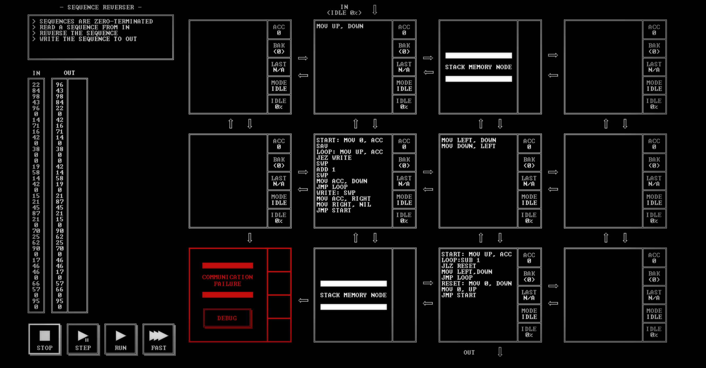

# SEQUENCE REVERSER

[Back to the solution index](../README.md)

## 1. Problem statement

Original text shown in the screenshot:

```text
SEQUENCES ARE ZERO-TERMINATED
READ A SEQUENCE FROM IN
REVERSE THE SEQUENCE
WRITE THE SEQUENCE TO OUT
```

## 2. Code for each node

**Numbering convention:** these are our own position numbers, not IDs displayed by the game. Positions are numbered from left to right and top to bottom, including blank nodes, communication failures, and stack memory nodes. Rows and columns start at 1.

```text
[ 1.] [ 2 ] [ 3S] [ 4.]
[ 5.] [ 6 ] [ 7 ] [ 8.]
[ 9!] [10S] [11 ] [12.]

! = COMMUNICATION FAILURE
S = STACK MEMORY NODE
. = visibly blank code area
```

`IN` enters above node 2; `OUT` leaves below node 11. Stack memory is present at positions 3 and 10; the visible program uses position 10.

### Node 1 — row 1, column 1

The code area is visibly blank.

### Node 2 — row 1, column 2

```asm
MOV UP, DOWN
```

### Node 3 — row 1, column 3

Displays `STACK MEMORY NODE`. No instruction listing is shown.

### Node 4 — row 1, column 4

The code area is visibly blank.

### Node 5 — row 2, column 1

The code area is visibly blank.

### Node 6 — row 2, column 2

```asm
START: MOV 0, ACC
SAV
LOOP: MOV UP, ACC
JEZ WRITE
SWP
ADD 1
SWP
MOV ACC, DOWN
JMP LOOP
WRITE: SWP
MOV ACC, RIGHT
MOV RIGHT, NIL
JMP START
```

### Node 7 — row 2, column 3

```asm
MOV LEFT, DOWN
MOV DOWN, LEFT
```

### Node 8 — row 2, column 4

The code area is visibly blank.

### Node 9 — row 3, column 1

Displays `COMMUNICATION FAILURE` and a `DEBUG` button. No code is visible.

### Node 10 — row 3, column 2

Displays `STACK MEMORY NODE`. No instruction listing is shown.

### Node 11 — row 3, column 3

```asm
START: MOV UP, ACC
LOOP:SUB 1
JLZ RESET
MOV LEFT,DOWN
JMP LOOP
RESET: MOV 0, DOWN
MOV 0, UP
JMP START
```

### Node 12 — row 3, column 4

The code area is visibly blank.

## 3. Screenshots

Original screenshot, copied without modification. Open the image to inspect the full-size source.



## 4. Brief explanation

Node 2 forwards the input to node 6. Node 6 counts nonzero values in its saved register and pushes each value down into stack node 10. At the zero terminator it sends the count right through node 7 to node 11.

Node 11 reads exactly that many values from the stack on its left, writing them down in last-in, first-out order. It then writes the sequence terminator and sends an acknowledgment upward. Node 7 forwards that acknowledgment left to node 6, which waits for it before beginning another sequence. This separates the stack-filling and stack-draining phases. A zero-length sequence goes directly to the terminator path.

**Transcription confidence: high.** The visible instructions, operands, labels, and node positions are readable. This grid has 4 nodes with code, 5 visibly blank code areas, 1 communication failure position(s), and 2 stack memory node(s).

**Verification limit:** this screenshot shows the code in an idle state, with no completion screen or score. The explanation is a reading of the visible program, not a claim of a successful run. Target output values or target images are not execution results. No performance metrics are recorded.
