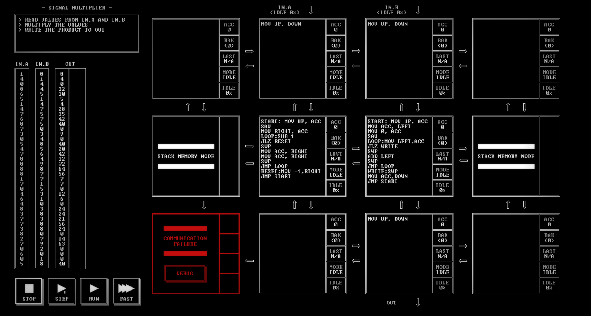

# SIGNAL MULTIPLIER

[Back to the solution index](../README.md)

## 1. Problem statement

Original text shown in the screenshot:

```text
READ VALUES FROM IN.A AND IN.B
MULTIPLY THE VALUES
WRITE THE PRODUCT TO OUT
```

## 2. Code for each node

**Numbering convention:** these are our own position numbers, not IDs displayed by the game. Positions are numbered from left to right and top to bottom, including blank nodes, communication failures, and stack memory nodes. Rows and columns start at 1.

```text
[ 1.] [ 2 ] [ 3 ] [ 4.]
[ 5S] [ 6 ] [ 7 ] [ 8S]
[ 9!] [10.] [11 ] [12.]

! = COMMUNICATION FAILURE
S = STACK MEMORY NODE
. = visibly blank code area
```

`IN.A` and `IN.B` enter above nodes 2 and 3. `OUT` leaves below node 11. Stack positions 5 and 8 are not used by the visible program.

### Node 1 — row 1, column 1

The code area is visibly blank.

### Node 2 — row 1, column 2

```asm
MOV UP, DOWN
```

### Node 3 — row 1, column 3

```asm
MOV UP, DOWN
```

### Node 4 — row 1, column 4

The code area is visibly blank.

### Node 5 — row 2, column 1

Displays `STACK MEMORY NODE`. No instruction listing is shown.

### Node 6 — row 2, column 2

```asm
START: MOV UP, ACC
SAV
MOV RIGHT, ACC
LOOP:SUB 1
JLZ RESET
SWP
MOV ACC, RIGHT
MOV ACC, RIGHT
SWP
JMP LOOP
RESET:MOV -1,RIGHT
JMP START
```

### Node 7 — row 2, column 3

```asm
START: MOV UP, ACC
MOV ACC, LEFT
MOV 0, ACC
SAV
LOOP:MOV LEFT,ACC
JLZ WRITE
SWP
ADD LEFT
SWP
JMP LOOP
WRITE:SWP
MOV ACC,DOWN
JMP START
```

### Node 8 — row 2, column 4

Displays `STACK MEMORY NODE`. No instruction listing is shown.

### Node 9 — row 3, column 1

Displays `COMMUNICATION FAILURE` and a `DEBUG` button. No code is visible.

### Node 10 — row 3, column 2

The code area is visibly blank.

### Node 11 — row 3, column 3

```asm
MOV UP, DOWN
```

### Node 12 — row 3, column 4

The code area is visibly blank.

## 3. Screenshots

Original screenshot, copied without modification. Open the image to inspect the full-size source.



## 4. Brief explanation

Node 6 saves A and receives B from node 7 as a repetition count. For each repetition, it sends A twice to node 7. When the count is exhausted, it sends -1 as an end marker.

Node 7 uses the first copy to distinguish data from that marker, then adds the second copy to its saved running total. On the marker it emits the total through node 11. For the nonnegative inputs shown, this computes `A × B` by repeated addition, including a zero result when B is zero.

The amount of repeated work grows with B. The negative marker also means this particular protocol is not a general signed-multiplication implementation.

**Transcription confidence: high.** The visible instructions, operands, labels, and node positions are readable. This grid has 5 nodes with code, 4 visibly blank code areas, 1 communication failure position(s), and 2 stack memory node(s).

**Verification limit:** this screenshot shows the code in an idle state, with no completion screen or score. The explanation is a reading of the visible program, not a claim of a successful run. Target output values or target images are not execution results. No performance metrics are recorded.
