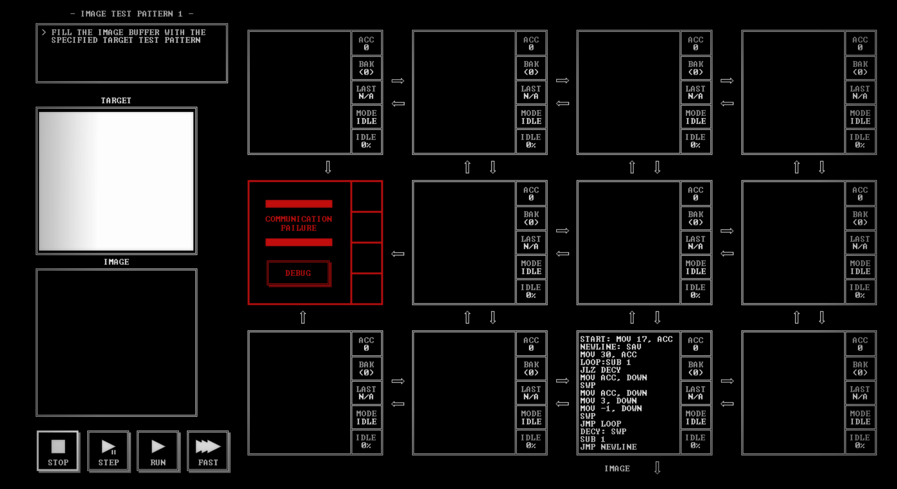

# IMAGE TEST PATTERN 1

[Back to the solution index](../README.md)

## 1. Problem statement

Original text shown in the screenshot:

```text
FILL THE IMAGE BUFFER WITH THE
SPECIFIED TARGET TEST PATTERN
```

## 2. Code for each node

**Numbering convention:** these are our own position numbers, not IDs displayed by the game. Positions are numbered from left to right and top to bottom, including blank nodes, communication failures, and stack memory nodes. Rows and columns start at 1.

```text
[ 1.] [ 2.] [ 3.] [ 4.]
[ 5!] [ 6.] [ 7.] [ 8.]
[ 9.] [10.] [11 ] [12.]

! = COMMUNICATION FAILURE
S = STACK MEMORY NODE
. = visibly blank code area
```

The `IMAGE` output is below node 11. No input stream is shown.

### Node 1 — row 1, column 1

The code area is visibly blank.

### Node 2 — row 1, column 2

The code area is visibly blank.

### Node 3 — row 1, column 3

The code area is visibly blank.

### Node 4 — row 1, column 4

The code area is visibly blank.

### Node 5 — row 2, column 1

Displays `COMMUNICATION FAILURE` and a `DEBUG` button. No code is visible.

### Node 6 — row 2, column 2

The code area is visibly blank.

### Node 7 — row 2, column 3

The code area is visibly blank.

### Node 8 — row 2, column 4

The code area is visibly blank.

### Node 9 — row 3, column 1

The code area is visibly blank.

### Node 10 — row 3, column 2

The code area is visibly blank.

### Node 11 — row 3, column 3

```asm
START: MOV 17, ACC
NEWLINE: SAV
MOV 30, ACC
LOOP:SUB 1
JLZ DECY
MOV ACC, DOWN
SWP
MOV ACC, DOWN
MOV 3, DOWN
MOV -1, DOWN
SWP
JMP LOOP
DECY: SWP
SUB 1
JMP NEWLINE
```

### Node 12 — row 3, column 4

The code area is visibly blank.

## 3. Screenshots

Original screenshot, copied without modification. Open the image to inspect the full-size source.



## 4. Brief explanation

Node 11 generates the output by itself. It begins with row coordinate 17, saves that coordinate, then counts the column coordinate down from 29 to 0. For each position it sends the group `x, y, 3, -1` down. `SWP` alternates between the column counter and saved row coordinate.

When the column counter becomes negative, the code decrements the row coordinate and starts another row. The initial sweep covers columns 29–0 and rows 17–0. The visible target is a white field; the separate `IMAGE` panel is still black in this screenshot. There is no explicit stop after row 0 in the transcribed program.

**Transcription confidence: high.** The visible instructions, operands, labels, and node positions are readable. This grid has 1 nodes with code, 10 visibly blank code areas, 1 communication failure position(s), and 0 stack memory node(s).

**Verification limit:** this screenshot shows the code in an idle state, with no completion screen or score. The explanation is a reading of the visible program, not a claim of a successful run. Target output values or target images are not execution results. No performance metrics are recorded.
