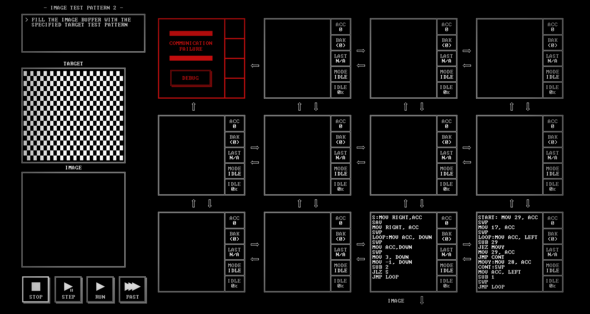

# IMAGE TEST PATTERN 2

[Back to the solution index](../README.md)

## 1. Problem statement

Original text shown in the screenshot:

```text
FILL THE IMAGE BUFFER WITH THE
SPECIFIED TARGET TEST PATTERN
```

## 2. Code for each node

**Numbering convention:** these are our own position numbers, not IDs displayed by the game. Positions are numbered from left to right and top to bottom, including blank nodes, communication failures, and stack memory nodes. Rows and columns start at 1.

```text
[ 1!] [ 2.] [ 3.] [ 4.]
[ 5.] [ 6.] [ 7.] [ 8.]
[ 9.] [10.] [11 ] [12 ]

! = COMMUNICATION FAILURE
S = STACK MEMORY NODE
. = visibly blank code area
```

The `IMAGE` output is below node 11. Node 12 supplies row setup values from the right; no input stream is shown.

### Node 1 — row 1, column 1

Displays `COMMUNICATION FAILURE` and a `DEBUG` button. No code is visible.

### Node 2 — row 1, column 2

The code area is visibly blank.

### Node 3 — row 1, column 3

The code area is visibly blank.

### Node 4 — row 1, column 4

The code area is visibly blank.

### Node 5 — row 2, column 1

The code area is visibly blank.

### Node 6 — row 2, column 2

The code area is visibly blank.

### Node 7 — row 2, column 3

The code area is visibly blank.

### Node 8 — row 2, column 4

The code area is visibly blank.

### Node 9 — row 3, column 1

The code area is visibly blank.

### Node 10 — row 3, column 2

The code area is visibly blank.

### Node 11 — row 3, column 3

```asm
S:MOV RIGHT,ACC
SAV
MOV RIGHT, ACC
SWP
LOOP:MOV ACC, DOWN
SWP
MOV ACC,DOWN
SWP
MOV 3, DOWN
MOV -1, DOWN
SUB 2
JLZ S
JMP LOOP
```

### Node 12 — row 3, column 4

```asm
START: MOV 29, ACC
SWP
MOV 17, ACC
SWP
LOOP:MOV ACC, LEFT
SUB 29
JEZ MOVY
MOV 29, ACC
JMP CONT
MOVY:MOV 28, ACC
CONT:SWP
MOV ACC, LEFT
SUB 1
SWP
JMP LOOP
```

## 3. Screenshots

Original screenshot, copied without modification. Open the image to inspect the full-size source.



## 4. Brief explanation

Node 12 sends a starting column and row to node 11. The starting column alternates between 29 and 28, while the row coordinate decreases from 17.

Node 11 emits groups `x, y, 3, -1`, decreasing x by 2 between pixels. When x becomes negative, it receives the next row setup. Alternating the starting column shifts the selected pixels by one column on successive rows, describing the checkerboard shown in `TARGET`.

The separate `IMAGE` panel is still black. As transcribed, node 12 continues decrementing the row coordinate without an explicit stop at row 0.

**Transcription confidence: high.** The visible instructions, operands, labels, and node positions are readable. This grid has 2 nodes with code, 9 visibly blank code areas, 1 communication failure position(s), and 0 stack memory node(s).

**Verification limit:** this screenshot shows the code in an idle state, with no completion screen or score. The explanation is a reading of the visible program, not a claim of a successful run. Target output values or target images are not execution results. No performance metrics are recorded.
