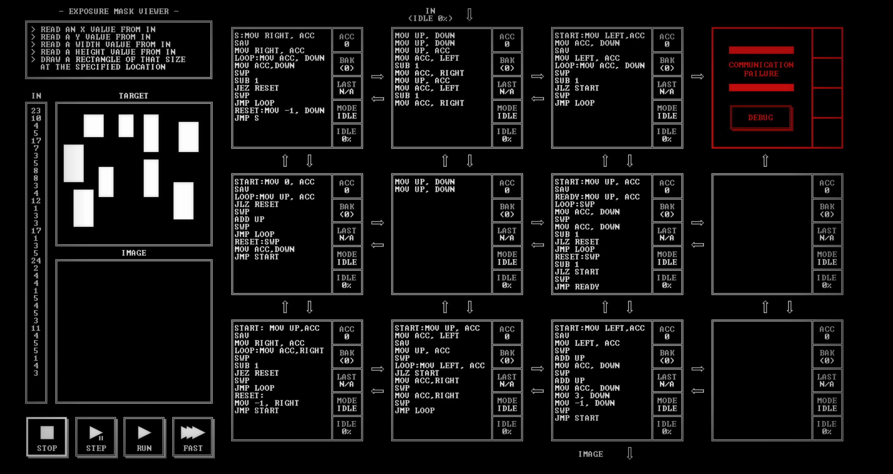

# EXPOSURE MASK VIEWER

[Back to the solution index](../README.md)

## 1. Problem statement

Original text shown in the screenshot:

```text
READ AN X VALUE FROM IN
READ A Y VALUE FROM IN
READ A WIDTH VALUE FROM IN
READ A HEIGHT VALUE FROM IN
DRAW A RECTANGLE OF THAT SIZE
AT THE SPECIFIED LOCATION
```

## 2. Code for each node

**Numbering convention:** these are our own position numbers, not IDs displayed by the game. Positions are numbered from left to right and top to bottom, including blank nodes, communication failures, and stack memory nodes. Rows and columns start at 1.

```text
[ 1 ] [ 2 ] [ 3 ] [ 4!]
[ 5 ] [ 6 ] [ 7 ] [ 8.]
[ 9 ] [10 ] [11 ] [12.]

! = COMMUNICATION FAILURE
S = STACK MEMORY NODE
. = visibly blank code area
```

`IN` enters above node 2; the `IMAGE` output is below node 11.

### Node 1 — row 1, column 1

```asm
S:MOV RIGHT, ACC
SAV
MOV RIGHT, ACC
LOOP:MOV ACC, DOWN
MOV ACC,DOWN
SWP
SUB 1
JEZ RESET
SWP
JMP LOOP
RESET:MOV -1, DOWN
JMP S
```

### Node 2 — row 1, column 2

```asm
MOV UP, DOWN
MOV UP, DOWN
MOV UP, ACC
MOV ACC, LEFT
SUB 1
MOV ACC, RIGHT
MOV UP, ACC
MOV ACC, LEFT
SUB 1
MOV ACC, RIGHT
```

### Node 3 — row 1, column 3

```asm
START:MOV LEFT,ACC
MOV ACC, DOWN
SAV
MOV LEFT, ACC
LOOP:MOV ACC, DOWN
SWP
SUB 1
JLZ START
SWP
JMP LOOP
```

### Node 4 — row 1, column 4

Displays `COMMUNICATION FAILURE` and a `DEBUG` button. No code is visible.

### Node 5 — row 2, column 1

```asm
START:MOV 0, ACC
SAV
LOOP:MOV UP, ACC
JLZ RESET
SWP
ADD UP
SWP
JMP LOOP
RESET:SWP
MOV ACC,DOWN
JMP START
```

### Node 6 — row 2, column 2

```asm
MOV UP, DOWN
MOV UP, DOWN
```

### Node 7 — row 2, column 3

```asm
START:MOV UP, ACC
SAV
READY:MOV UP, ACC
LOOP:SWP
MOV ACC, DOWN
SWP
MOV ACC, DOWN
SUB 1
JLZ RESET
JMP LOOP
RESET:SWP
SUB 1
JLZ START
SWP
JMP READY
```

### Node 8 — row 2, column 4

The code area is visibly blank.

### Node 9 — row 3, column 1

```asm
START: MOV UP,ACC
SAV
MOV RIGHT, ACC
LOOP:MOV ACC,RIGHT
SWP
SUB 1
JEZ RESET
SWP
JMP LOOP
RESET:
MOV -1, RIGHT
JMP START
```

### Node 10 — row 3, column 2

```asm
START:MOV UP, ACC
MOV ACC, LEFT
SAV
MOV UP, ACC
SWP
LOOP:MOV LEFT, ACC
JLZ START
MOV ACC,RIGHT
SWP
MOV ACC,RIGHT
SWP
JMP LOOP
```

### Node 11 — row 3, column 3

```asm
START:MOV LEFT,ACC
SAV
MOV LEFT, ACC
SWP
ADD UP
MOV ACC, DOWN
SWP
ADD UP
MOV ACC, DOWN
MOV 3, DOWN
MOV -1, DOWN
SWP
JMP START
```

### Node 12 — row 3, column 4

The code area is visibly blank.

## 3. Screenshots

Original screenshot, copied without modification. Open the image to inspect the full-size source.



## 4. Brief explanation

Node 2 separates each rectangle description: the origin `(x, y)` goes down through node 6, the full width and height go left, and width minus one and height minus one go right.

On the left, nodes 1 and 5 compute the pixel count by repeatedly adding the height, once per column. Node 9 uses that count to request one origin copy per pixel from node 10, followed by a negative end marker.

On the right, nodes 3 and 7 generate offset pairs. The horizontal offset counts from `width - 1` down to 0; for each column, the vertical offset counts from `height - 1` down to 0.

Node 11 receives an origin pair from the left and an offset pair from above, adds the corresponding coordinates, and emits `x + dx, y + dy, 3, -1`. The two sides therefore need to supply the same `width × height` number of pixels per rectangle. The target panel shows the intended rectangles; the output image panel is still black.

**Transcription confidence: high.** The visible instructions, operands, labels, and node positions are readable. This grid has 9 nodes with code, 2 visibly blank code areas, 1 communication failure position(s), and 0 stack memory node(s).

**Verification limit:** this screenshot shows the code in an idle state, with no completion screen or score. The explanation is a reading of the visible program, not a claim of a successful run. Target output values or target images are not execution results. No performance metrics are recorded.
