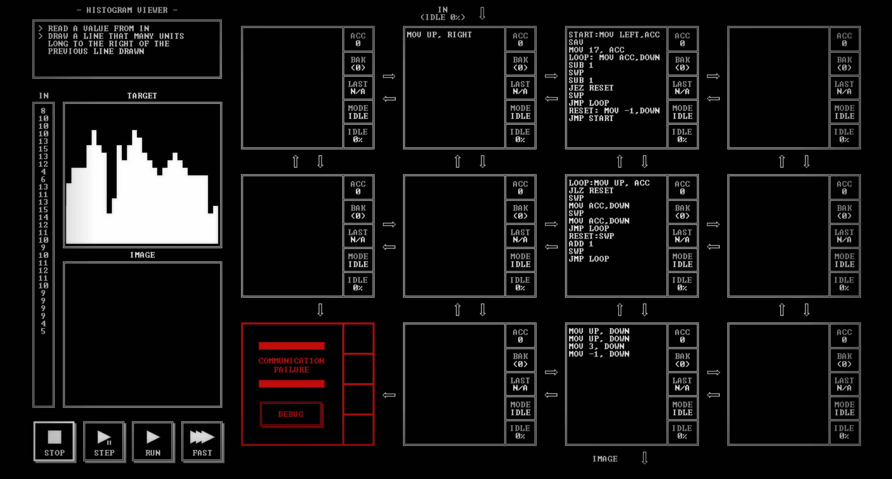

# HISTOGRAM VIEWER

[Back to the solution index](../README.md)

## 1. Problem statement

Original text shown in the screenshot:

```text
READ A VALUE FROM IN
DRAW A LINE THAT MANY UNITS
LONG TO THE RIGHT OF THE
PREVIOUS LINE DRAWN
```

## 2. Code for each node

**Numbering convention:** these are our own position numbers, not IDs displayed by the game. Positions are numbered from left to right and top to bottom, including blank nodes, communication failures, and stack memory nodes. Rows and columns start at 1.

```text
[ 1.] [ 2 ] [ 3 ] [ 4.]
[ 5.] [ 6.] [ 7 ] [ 8.]
[ 9!] [10.] [11 ] [12.]

! = COMMUNICATION FAILURE
S = STACK MEMORY NODE
. = visibly blank code area
```

`IN` enters above node 2; the `IMAGE` output is below node 11.

### Node 1 — row 1, column 1

The code area is visibly blank.

### Node 2 — row 1, column 2

```asm
MOV UP, RIGHT
```

### Node 3 — row 1, column 3

```asm
START:MOV LEFT,ACC
SAV
MOV 17, ACC
LOOP: MOV ACC,DOWN
SUB 1
SWP
SUB 1
JEZ RESET
SWP
JMP LOOP
RESET: MOV -1,DOWN
JMP START
```

### Node 4 — row 1, column 4

The code area is visibly blank.

### Node 5 — row 2, column 1

The code area is visibly blank.

### Node 6 — row 2, column 2

The code area is visibly blank.

### Node 7 — row 2, column 3

```asm
LOOP:MOV UP, ACC
JLZ RESET
SWP
MOV ACC,DOWN
SWP
MOV ACC,DOWN
JMP LOOP
RESET:SWP
ADD 1
SWP
JMP LOOP
```

### Node 8 — row 2, column 4

The code area is visibly blank.

### Node 9 — row 3, column 1

Displays `COMMUNICATION FAILURE` and a `DEBUG` button. No code is visible.

### Node 10 — row 3, column 2

The code area is visibly blank.

### Node 11 — row 3, column 3

```asm
MOV UP, DOWN
MOV UP, DOWN
MOV 3, DOWN
MOV -1, DOWN
```

### Node 12 — row 3, column 4

The code area is visibly blank.

## 3. Screenshots

Original screenshot, copied without modification. Open the image to inspect the full-size source.



## 4. Brief explanation

Node 2 forwards each height to node 3. For the positive heights shown, node 3 sends that many row coordinates, starting at 17 and moving upward by decrementing the coordinate. It then sends -1 to mark the end of the column.

Node 7 keeps the current column in its saved register. For each row coordinate it emits the current column followed by that row. A negative marker advances the column instead of producing a pixel. Node 11 appends `3, -1` to each coordinate pair.

This describes the vertical bars shown in the target. The explanation is limited to the positive input heights visible here; the code checks its height counter after drawing a pixel.

**Transcription confidence: high.** The visible instructions, operands, labels, and node positions are readable. This grid has 4 nodes with code, 7 visibly blank code areas, 1 communication failure position(s), and 0 stack memory node(s).

**Verification limit:** this screenshot shows the code in an idle state, with no completion screen or score. The explanation is a reading of the visible program, not a claim of a successful run. Target output values or target images are not execution results. No performance metrics are recorded.
