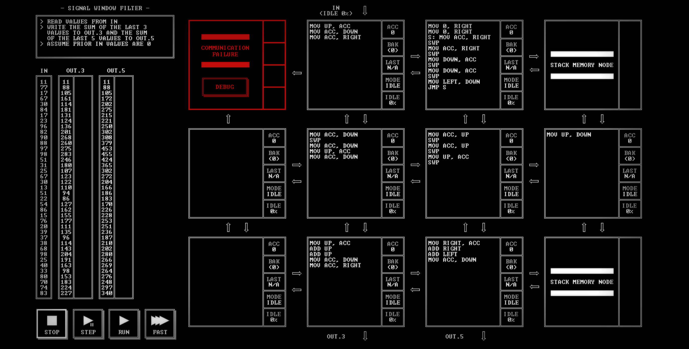

# SIGNAL WINDOW FILTER

[Back to the solution index](../README.md)

## 1. Problem statement

Original text shown in the screenshot:

```text
READ VALUES FROM IN
WRITE THE SUM OF THE LAST 3
VALUES TO OUT.3 AND THE SUM
OF THE LAST 5 VALUES TO OUT.5
ASSUME PRIOR IN VALUES ARE 0
```

## 2. Code for each node

**Numbering convention:** these are our own position numbers, not IDs displayed by the game. Positions are numbered from left to right and top to bottom, including blank nodes, communication failures, and stack memory nodes. Rows and columns start at 1.

```text
[ 1!] [ 2 ] [ 3 ] [ 4S]
[ 5.] [ 6 ] [ 7 ] [ 8 ]
[ 9.] [10 ] [11 ] [12S]

! = COMMUNICATION FAILURE
S = STACK MEMORY NODE
. = visibly blank code area
```

`IN` enters above node 2. `OUT.3` leaves below node 10; `OUT.5` below node 11. Stack memory occupies positions 4 and 12.

### Node 1 — row 1, column 1

Displays `COMMUNICATION FAILURE` and a `DEBUG` button. No code is visible.

### Node 2 — row 1, column 2

```asm
MOV UP, ACC
MOV ACC, DOWN
MOV ACC, RIGHT
```

### Node 3 — row 1, column 3

```asm
MOV 0, RIGHT
MOV 0, RIGHT
S: MOV ACC, RIGHT
SWP
MOV ACC, RIGHT
SWP
MOV DOWN, ACC
SWP
MOV DOWN, ACC
SWP
MOV LEFT, DOWN
JMP S
```

### Node 4 — row 1, column 4

Displays `STACK MEMORY NODE`. No instruction listing is shown.

### Node 5 — row 2, column 1

The code area is visibly blank.

### Node 6 — row 2, column 2

```asm
MOV ACC, DOWN
SWP
MOV ACC, DOWN
MOV UP, ACC
MOV ACC, DOWN
```

### Node 7 — row 2, column 3

```asm
MOV ACC, UP
SWP
MOV ACC, UP
SWP
MOV UP, ACC
SWP
```

### Node 8 — row 2, column 4

```asm
MOV UP, DOWN
```

### Node 9 — row 3, column 1

The code area is visibly blank.

### Node 10 — row 3, column 2

```asm
MOV UP, ACC
ADD UP
ADD UP
MOV ACC, DOWN
MOV ACC, RIGHT
```

### Node 11 — row 3, column 3

```asm
MOV RIGHT, ACC
ADD RIGHT
ADD LEFT
MOV ACC, DOWN
```

### Node 12 — row 3, column 4

Displays `STACK MEMORY NODE`. No instruction listing is shown.

## 3. Screenshots

Original screenshot, copied without modification. Open the image to inspect the full-size source.



## 4. Brief explanation

Node 2 sends each sample into two paths. On the left, node 6 sends its two retained values followed by the current sample to node 10. Node 10 adds the three values, writes the total to `OUT.3`, and sends the same total right to node 11.

On the right, nodes 3 and 7 exchange saved samples to retain older history. Node 3 sends pairs into stack node 4, node 8 transfers values down into stack node 12, and node 11 reads two values from that stack. It adds those older values to the three-sample total from node 10 to form the five-sample total.

The initial register values and the two explicit zero writes in node 3 provide the initial zero history. The order of the two extra samples does not affect their sum, but matching them with the correct three-sample total depends on the communication order.

**Transcription confidence: high.** The visible instructions, operands, labels, and node positions are readable. This grid has 7 nodes with code, 2 visibly blank code areas, 1 communication failure position(s), and 2 stack memory node(s).

**Verification limit:** this screenshot shows the code in an idle state, with no completion screen or score. The explanation is a reading of the visible program, not a claim of a successful run. Target output values or target images are not execution results. No performance metrics are recorded.
