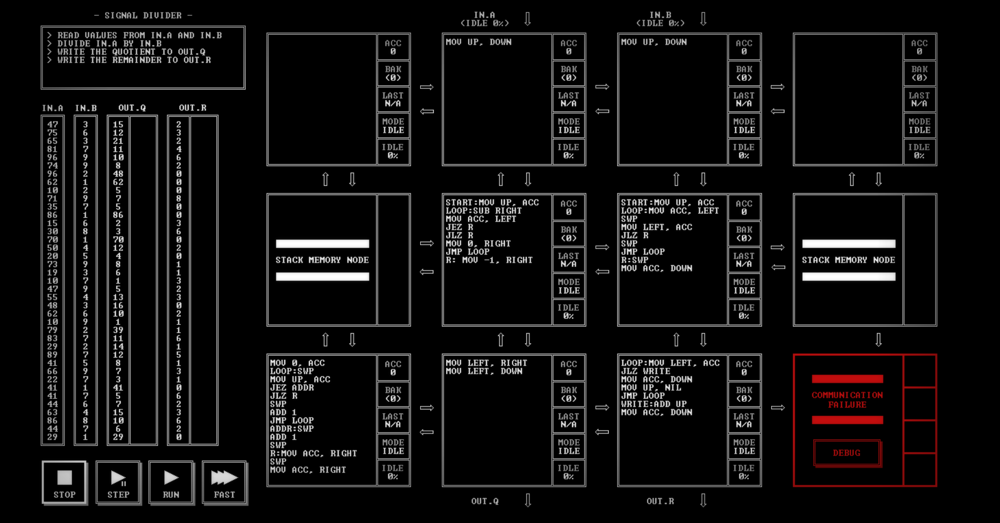

# SIGNAL DIVIDER

[Back to the solution index](../README.md)

## 1. Problem statement

Original text shown in the screenshot:

```text
READ VALUES FROM IN.A AND IN.B
DIVIDE IN.A BY IN.B
WRITE THE QUOTIENT TO OUT.Q
WRITE THE REMAINDER TO OUT.R
```

## 2. Code for each node

**Numbering convention:** these are our own position numbers, not IDs displayed by the game. Positions are numbered from left to right and top to bottom, including blank nodes, communication failures, and stack memory nodes. Rows and columns start at 1.

```text
[ 1.] [ 2 ] [ 3 ] [ 4.]
[ 5S] [ 6 ] [ 7 ] [ 8S]
[ 9 ] [10 ] [11 ] [12!]

! = COMMUNICATION FAILURE
S = STACK MEMORY NODE
. = visibly blank code area
```

`IN.A` and `IN.B` enter above nodes 2 and 3. `OUT.Q` leaves below node 10; `OUT.R` below node 11. The visible program uses stack position 5; stack position 8 is unused.

### Node 1 — row 1, column 1

The code area is visibly blank.

### Node 2 — row 1, column 2

```asm
MOV UP, DOWN
```

### Node 3 — row 1, column 3

```asm
MOV UP, DOWN
```

### Node 4 — row 1, column 4

The code area is visibly blank.

### Node 5 — row 2, column 1

Displays `STACK MEMORY NODE`. No instruction listing is shown.

### Node 6 — row 2, column 2

```asm
START:MOV UP, ACC
LOOP:SUB RIGHT
MOV ACC, LEFT
JEZ R
JLZ R
MOV 0, RIGHT
JMP LOOP
R: MOV -1, RIGHT
```

### Node 7 — row 2, column 3

```asm
START:MOV UP, ACC
LOOP:MOV ACC, LEFT
SWP
MOV LEFT, ACC
JLZ R
SWP
JMP LOOP
R:SWP
MOV ACC, DOWN
```

### Node 8 — row 2, column 4

Displays `STACK MEMORY NODE`. No instruction listing is shown.

### Node 9 — row 3, column 1

```asm
MOV 0, ACC
LOOP:SWP
MOV UP, ACC
JEZ ADDR
JLZ R
SWP
ADD 1
JMP LOOP
ADDR:SWP
ADD 1
SWP
R:MOV ACC, RIGHT
SWP
MOV ACC,RIGHT
```

### Node 10 — row 3, column 2

```asm
MOV LEFT, RIGHT
MOV LEFT, DOWN
```

### Node 11 — row 3, column 3

```asm
LOOP:MOV LEFT, ACC
JLZ WRITE
MOV ACC, DOWN
MOV UP, NIL
JMP LOOP
WRITE:ADD UP
MOV ACC, DOWN
```

### Node 12 — row 3, column 4

Displays `COMMUNICATION FAILURE` and a `DEBUG` button. No code is visible.

## 3. Screenshots

Original screenshot, copied without modification. Open the image to inspect the full-size source.



## 4. Brief explanation

Node 6 repeatedly subtracts B from A, receiving B from node 7 each time. Every subtraction result is sent left into stack node 5. A zero or negative result ends the subtraction loop; the negative control message sent right tells node 7 to forward B down for the remainder calculation.

Node 9 reads the subtraction results and counts the successful subtractions. A zero result counts as one final exact subtraction; a negative result does not. It sends the terminal result followed by the quotient to node 10. Node 10 routes the terminal result right and the quotient down to `OUT.Q`.

Node 11 turns the terminal result into the remainder. Zero is written directly and the accompanying B is consumed without use. A negative overshoot is corrected by adding B once. The result goes to `OUT.R`.

For example, with A = 47 and B = 3, the fifteenth subtraction leaves 2 and the sixteenth leaves -1. The quotient is 15 and the corrected remainder is `-1 + 3 = 2`. This reading assumes the positive divisors shown in the screenshot; it does not establish division-by-zero handling.

**Transcription confidence: high.** The visible instructions, operands, labels, and node positions are readable. This grid has 7 nodes with code, 2 visibly blank code areas, 1 communication failure position(s), and 2 stack memory node(s).

**Verification limit:** this screenshot shows the code in an idle state, with no completion screen or score. The explanation is a reading of the visible program, not a claim of a successful run. Target output values or target images are not execution results. No performance metrics are recorded.
