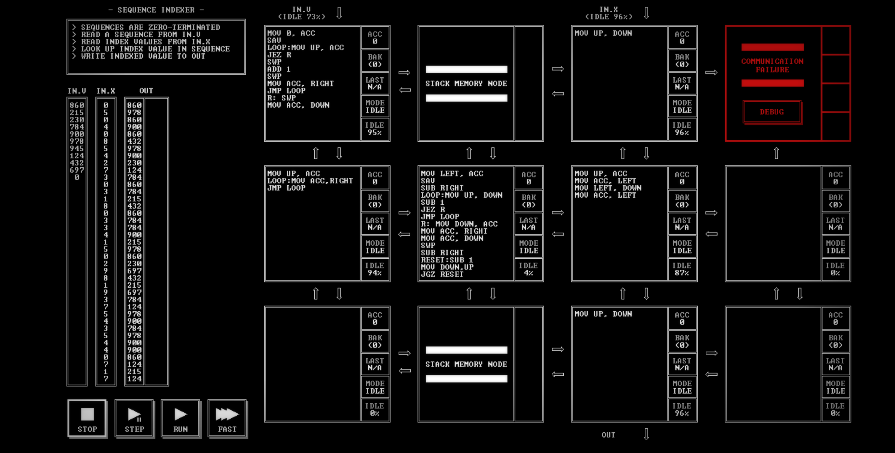

# SEQUENCE INDEXER

[Back to the solution index](../README.md)

## 1. Problem statement

Original text shown in the screenshot:

```text
SEQUENCES ARE ZERO-TERMINATED
READ A SEQUENCE FROM IN.U
READ INDEX VALUES FROM IN.X
LOOK UP INDEX VALUE IN SEQUENCE
WRITE INDEXED VALUE TO OUT
```

## 2. Code for each node

**Numbering convention:** these are our own position numbers, not IDs displayed by the game. Positions are numbered from left to right and top to bottom, including blank nodes, communication failures, and stack memory. Rows and columns start at 1.

```text
[ 1 ] [ 2S] [ 3 ] [ 4!]
[ 5 ] [ 6 ] [ 7 ] [ 8.]
[ 9.] [10S] [11 ] [12.]

! = COMMUNICATION FAILURE
S = STACK MEMORY NODE
. = visibly blank code area
```

`IN.U` enters above node 1; `IN.X` enters above node 3. `OUT` leaves below node 11. Stack nodes are at positions 2 and 10.

### Node 1 — row 1, column 1

```asm
MOV 0, ACC
SAV
LOOP:MOV UP, ACC
JEZ R
SWP
ADD 1
SWP
MOV ACC,RIGHT
JMP LOOP
R: SWP
MOV ACC,DOWN
```

### Node 2 — row 1, column 2

Displays `STACK MEMORY NODE`. No instruction listing is shown.

### Node 3 — row 1, column 3

```asm
MOV UP, DOWN
```

### Node 4 — row 1, column 4

Displays `COMMUNICATION FAILURE` and a `DEBUG` button. No code is visible.

### Node 5 — row 2, column 1

```asm
MOV UP, ACC
LOOP:MOV ACC,RIGHT
JMP LOOP
```

### Node 6 — row 2, column 2

```asm
MOV LEFT, ACC
SAV
SUB RIGHT
LOOP:MOV UP, DOWN
SUB 1
JEZ R
JMP LOOP
R: MOV DOWN, ACC
MOV ACC, RIGHT
MOV ACC, DOWN
SWP
SUB RIGHT
RESET:SUB 1
MOV DOWN,UP
JGZ RESET
```

### Node 7 — row 2, column 3

```asm
MOV UP, ACC
MOV ACC, LEFT
MOV LEFT, DOWN
MOV ACC, LEFT
```

### Node 8 — row 2, column 4

The code area is visibly blank.

### Node 9 — row 3, column 1

The code area is visibly blank.

### Node 10 — row 3, column 2

Displays `STACK MEMORY NODE`. No instruction listing is shown.

### Node 11 — row 3, column 3

```asm
MOV UP, ACC
MOV ACC, LEFT
MOV LEFT, DOWN
MOV ACC, LEFT
```

### Node 12 — row 3, column 4

The code area is visibly blank.

## 3. Screenshots

Original screenshot, copied without modification. Open the image to inspect the full-size source.



## 4. Brief explanation

The visible layout places the sequence input `IN.U` above node 1 and the index input `IN.X` above node 3. Node 1 increments a saved counter as it reads the sequence stream, while node 5 forwards values arriving from above. Node 6 contains the comparison and routing instructions; the stack nodes and neighboring nodes provide additional paths through the grid. Node 11 sends values downward to `OUT`. This describes the visible wiring and instructions without assuming details that are not established by a completed run.

The input columns display progress values of 95% and 96%, and the output column contains values. The screenshot therefore records an in-progress state; it does not show an explicit completion screen or score.

**Transcription confidence: high.** The displayed instructions, labels, status text, and node positions are readable. The screenshot contains 6 nodes with code, 3 visibly blank code areas, 1 communication failure position, and 2 stack memory nodes.

**Verification limit:** the screenshot shows partial output while inputs are near the ends of their displayed streams, but no completion screen or score. This is not independent verification of a completed run. No performance metrics are recorded.
